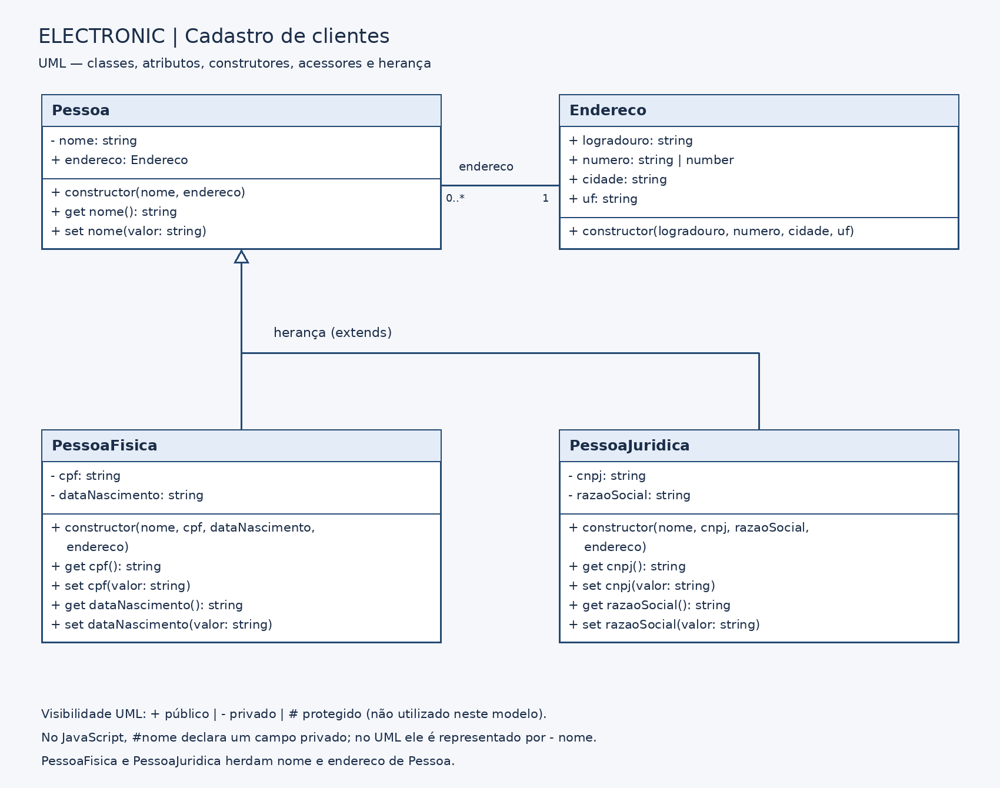

# Cadastro de Clientes da Electronic

**Estudante:** Vitor Felipe Lima Albrecht  
**Atividade 01 — Cadastro de Clientes da Electronic: da Modelagem ao Código**

O programa cadastra pessoas físicas e jurídicas usando orientação a objetos em JavaScript. PessoaFisica e PessoaJuridica herdam nome e endereço de Pessoa. Nome, CPF, data de nascimento, CNPJ e razão social usam campos privados, getters e setters.

As validações lançam erros com `throw`, tratados com `try/catch`. O cliente só é adicionado à lista se a criação for concluída sem erro. Ao final, o programa mostra apenas os clientes válidos.

## Arquivos

- `index.js`: classes, validações, quatro cenários de teste e lista de clientes.
- `diagrama.drawio`: diagrama de classes editável no Draw.io.
- `diagrama.png`: imagem do diagrama.

## Como executar

Com o Node.js instalado, abra o terminal na pasta do projeto e execute:

```bash
node index.js
```

## Diagrama de classes



No UML, `+` indica público, `-` privado e `#` protegido. O modelo usa atributos públicos e privados; não possui membros protegidos. No código JavaScript, `#` indica um campo privado.

## Validações

- Nome com pelo menos 3 caracteres.
- CPF com 11 dígitos e CNPJ com 14 dígitos, desconsiderando pontos, traços e barras.
- Data de nascimento válida, no formato AAAA-MM-DD, sem aceitar datas futuras.
- Razão social obrigatória.

## Testes

Foram executados os quatro cenários: pessoa física válida, pessoa física inválida, pessoa jurídica válida e pessoa jurídica inválida. Nos casos inválidos foram usados CPF e CNPJ com quantidade incorreta de dígitos. Os dados dos exemplos são fictícios.

Saída obtida no terminal ao executar `node index.js`:

```text
Pessoa física válida: cadastrada com sucesso.
Pessoa física inválida: O CPF deve ter 11 dígitos.
Pessoa jurídica válida: cadastrada com sucesso.
Pessoa jurídica inválida: O CNPJ deve ter 14 dígitos.

CLIENTES CADASTRADOS:

Nome: Ana Souza
CPF: 52998224725
Data de nascimento: 1995-05-20
Endereço: Rua das Flores, 100 - Esteio/RS

Nome: Electronic
CNPJ: 11222333000181
Razão social: Electronic Comércio Ltda.
Endereço: Avenida Brasil, 300 - Esteio/RS
```
